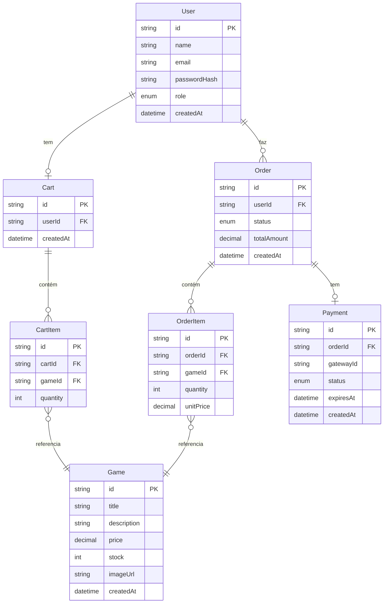

# 🛠️ Architecture / Software Design Document

**Projeto:** GameVault
**Versão:** 1.0.1 · gerado via `/utf-architecture`
**Última atualização:** 2026-10-15

> 🤖 **O `prd.md` responde _o quê_ o produto faz. Este responde _onde as coisas
> moram e como se chamam_.** Detalhe de tela — rota, componente, contrato —
> **não** se decide aqui: isso é trabalho da spec de cada história.

---

## 🤖 1. Fontes de Contexto para a IA

> Onde a IDE agêntica busca a verdade. **Isto é o índice; a configuração mora
> nos arquivos** — documento não configura ferramenta.

| Fonte | Onde configurar | Serve para |
| :---- | :-------------- | :--------- |
| Constituição da IA | `.agents/rules/utf-rules.md` (via `CLAUDE.md`) | Regras inegociáveis: fases do SDD, 2 rodadas, revisores distintos, Git |
| Fluxos da IA | `.agents/workflows/` | PRD, backlog, jornadas e tokens, architecture, setup, ciclo por Issue, ciclo por tarefa, tutor |
| Agentes (subagentes) | `.agents/agents/` (cascas em `.claude/`, `.cursor/` e `.opencode/`) | Implementador, revisores, auditor final e tutor |
| Ficha da disciplina | `docs/checklist.md` | Regras do projeto, IDs e entregas |
| Design (Stitch) | [https://stitch.withgoogle.com/projects/17513263099732936981](https://stitch.withgoogle.com/projects/17513263099732936981) | Cores, tipografia, hierarquia visual — tokens em `docs/design-tokens.md` |

---

## 📦 2. Stack Tecnológica

> Definição **estrita**: nenhuma dependência entra sem aparecer aqui. Esta
> seção e o `package.json` contam a mesma história, ou o projeto já se perdeu.

- **Backend:** NestJS 12 (projeto em ESM via gerador oficial) + Prisma ORM 7 + PostgreSQL
- **Frontend:** React 19 + Vite 8
- **Estilo:** CSS puro com os tokens de `docs/design-tokens.md` (Space Grotesk + Hanken Grotesk)
- **Testes e Lint:** Vitest em ambos os apps · Oxlint como linter padrão para os apps gerados

### Padrões de código — React 19

- Componentes de função com hooks (sem classes)
- Estado do servidor separado do estado de UI
- Roteamento com lazy loading por rota
- Componentes de página (`pages/`) distintos de componentes reutilizáveis (`components/`)
- **Regra da camada de dados:** componente não fala com o servidor — todo acesso à API passa pela camada `services/`; mudança de contrato mexe só nessa camada, nunca nas telas.

### 🧱 2.1. Backend — Regras Estruturais

> **É esta declaração que os revisores usam como critério fixo.**

**ID6 — Separação de camadas:**
Cada domínio segue estritamente: `Controller → Service → Module`. Controller só recebe e devolve HTTP; regra de negócio fica no Service; acesso ao banco fica no `PrismaService` (injetado no Service).

**ID7 — Validação de entrada:**
Toda entrada da API passa por **DTO com `class-validator`** + `ValidationPipe` global configurado com `whitelist: true, forbidNonWhitelisted: true`. Propriedades extras são descartadas silenciosamente.

**ID8 — CRUD relacional:**
Todas as operações de banco via **Prisma ORM** — sem queries SQL à mão, sem outro ORM.

**ID9 — Autenticação e controle de acesso:**
JWT (access token). Guard global `JwtAuthGuard` protege todas as rotas por padrão; rotas públicas recebem o decorator `@Public()`. Controle de roles com `RolesGuard` + decorator `@Roles(Role.ADMIN)` para rotas administrativas.

**ID10 — Formato de resposta e erros:**
- **Sucesso:** Interceptor global serializa respostas em `{ data: ... }`.
- **Erro:** `ExceptionFilter` global captura todas as exceções e devolve `{ statusCode, message, error }`. Erros `P2025` do Prisma (not found) viram `NotFoundException`; demais erros do Prisma viram `BadRequestException`.

**ID17 — Segredos e variáveis de ambiente:**
`ConfigModule` do NestJS carrega `.env` localmente; em produção e CI as variáveis são injetadas pela plataforma. `.env` está no `.gitignore`. Credenciais nunca aparecem em código, YAML de CI, nem neste documento.

**ID20/21 — Gateway de pagamento:**
**Mercado Pago** (sandbox). Fluxo: frontend cria preferência via backend → usuário paga no checkout externo → gateway envia webhook ao backend (`POST /webhooks/mercadopago`). O backend **verifica a assinatura** antes de processar. Chaves de API fora do repositório (via `ConfigModule`).

### 🌐 2.2. O Contrato da API

A documentação OpenAPI é gerada do código com `@nestjs/swagger` e servida em `/docs`. O frontend deriva os contratos dela. **Este documento não mantém tabela de endpoints à mão**, e o arquivo gerado **não é commitado** — a fonte é o endpoint vivo.

---

## 🗂️ 3. Estrutura do Repositório (Monorepo)

> Uma pasta por aplicação, cada uma com o seu `package.json`, gerenciadas via npm workspaces (`apps/*`). Sem Nx ou Turborepo — ferramenta sem problema para resolver é só custo.

```text
GameVault/
├── .agents/               # constituição, workflows e prompts dos agentes (§1)
├── .claude/ .cursor/ .opencode/   # cascas de cada ferramenta — só apontam para .agents/
├── .github/               # template de PR e o Portão de Entendimento
├── CLAUDE.md  AGENTS.md   # carregam a constituição em toda sessão
├── README.md              # a vitrine: o que é e como rodar
├── docs/                  # prd.md, user-flows.md, design-tokens.md, architecture.md, checklist.md
├── specs/                 # uma pasta por história implementada
└── apps/
    ├── api/               # NestJS 12 — organizado por módulo/domínio
    │   ├── src/
    │   │   ├── main.ts
    │   │   ├── app.module.ts
    │   │   ├── games/         # módulo: controller, service, dto, module
    │   │   ├── orders/
    │   │   ├── payments/
    │   │   ├── auth/
    │   │   ├── users/
    │   │   └── prisma/        # PrismaService + schema.prisma
    │   └── package.json
    └── web/               # React 19 + Vite — organizado por feature
        ├── src/
        │   ├── main.tsx
        │   ├── App.tsx
        │   ├── features/      # uma pasta por domínio de negócio
        │   │   └── store/
        │   │       ├── pages/       # componentes de página (rota)
        │   │       ├── components/  # componentes reutilizáveis do domínio
        │   │       └── services/    # camada de acesso à API
        │   ├── shared/        # componentes e services compartilhados entre features
        │   └── router.tsx
        └── package.json
```

- Scripts de orquestração da raiz criados usando `--prefix`.
- Arquivo inesperado de build `*.tsbuildinfo` adicionado ao `.gitignore`.

---

## 🏗️ 4. Arquitetura Frontend

> 📏 **A regra que vale para qualquer stack: componente não fala com o
> servidor.** Todo acesso à API passa por uma camada de repositório/serviço —
> mudança de contrato mexe só nessa camada, nunca nas telas.

O frontend é organizado por **feature/domínio** dentro de `src/features/`. Cada feature tem:

- `pages/` — componentes de página (montados por uma rota); orquestram os componentes filhos e chamam os services.
- `components/` — componentes reutilizáveis dentro daquele domínio.
- `services/` — toda chamada HTTP para a API; recebe e devolve tipos derivados da documentação OpenAPI (`/docs`). Nenhum componente faz `fetch` direto.

`src/shared/` guarda o que é reutilizado em mais de uma feature (ex.: botão genérico, hook de autenticação, toast de notificação).

---

## 🗄️ 5. Arquitetura de Dados

### 📖 5.1. Glossário Técnico (Mapeamento)

> A ponte entre o português do negócio (PRD §2) e o inglês do código.
> **Dados e código em inglês, interface em português.**

| Termo PRD (PT-BR) | Entidade técnica (EN) | Atributos principais |
| :---------------- | :-------------------- | :------------------- |
| jogo | `Game` | `id`, `title`, `description`, `price`, `stock`, `imageUrl`, `createdAt` |
| usuário | `User` | `id`, `name`, `email`, `passwordHash`, `role` (USER \| ADMIN), `createdAt` |
| carrinho | `Cart` | `id`, `userId`, `createdAt` |
| item do carrinho | `CartItem` | `id`, `cartId`, `gameId`, `quantity` |
| pedido (compra = pedido pago) | `Order` | `id`, `userId`, `status` (PENDING = aguardando pagamento \| PAID \| REFUSED \| EXPIRED), `totalAmount`, `createdAt` |
| item do pedido | `OrderItem` | `id`, `orderId`, `gameId`, `quantity`, `unitPrice` |
| pagamento (tentativa de pagamento) | `Payment` | `id`, `orderId`, `gatewayId`, `status` (PENDING \| PAID \| REFUSED \| EXPIRED), `expiresAt`, `createdAt` |

### 📊 5.2. Diagrama ER (Mermaid)



> **Notas:**
> - `unitPrice` em `OrderItem` é snapshot do preço na hora da compra (RN05: jogo removido não apaga histórico).
> - `Order` → `Payment` é 1:1 — um pedido não pode ter mais de um pagamento aprovado (RN03).
> - Pedido expirado não é reaberto (RN06): o retry cria um novo `Order`, por isso a relação segue 1:1.
> - `Cart` não baixa estoque; só `Order` com `Payment` PAID baixa estoque (RN01).

### 🌍 5.3. O Banco por Ambiente

| Ambiente | Onde roda | Como conecta |
| :--- | :--- | :--- |
| **Local** | Docker (PostgreSQL) | `DATABASE_URL` no `.env` local |
| **CI** | Docker service no GitHub Actions | `DATABASE_URL` no secret do repositório |
| **Produção** | Neon.tech (PostgreSQL serverless) | `DATABASE_URL` no secret da plataforma de hospedagem |

> 🔒 Credenciais **nunca** aparecem no repositório — nem em código, nem em
> YAML, nem neste documento. Só nos *secrets* da plataforma.

---

## 🗺️ 6. Mapa de Domínios

> **Este índice cresce.** Não é para preencher agora: **uma linha por história
> implementada**. Ele diz **onde mora** cada domínio e quem o protege — rota e
> contrato ficam na documentação viva da API (`/docs`) e na spec de cada história,
> nunca copiados aqui.

| Domínio | Módulo (pasta) | Guard | Dados (repository) | US |
| :------ | :------------- | :---- | :----------------- | :-- |
| | | | | |

---

## 📅 7. Histórico

| Data | Versão | O que mudou |
| :--- | :----- | :---------- |
| 2026-10-16 | 1.0.1 | Glossário técnico: sinônimos (compra, tentativa de pagamento, aguardando pagamento) e valores de `Payment.status`; nota do retry = novo `Order` |
| 2026-10-15 | 1.0.0 | Versão inicial via `/utf-architecture` |

---

## 🛑 O que ainda **não** está neste documento

Detalhes de funcionalidade — DTOs de endpoints específicos, máquinas de estado
de uma história — **não entram aqui**: nascem sob demanda no `spec.md` de cada
história. Este documento guarda só o que vale para o sistema inteiro.
